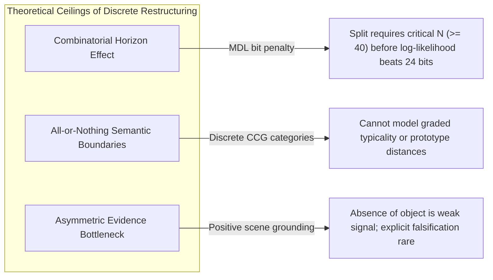

# NEXUS-0 Phase 3: Restructuring Limitations & Divergence Analysis (`LIMITATIONS_P3.md`)

**Date**: 2026-10-27  
**Stage**: STAGE P3-E (Exploratory Analysis & Theoretical Limits)  
**Related Documents**: `PHASE3_REPORT.md`, `PREREGISTRATION_P3.md`, `AUDIT_P3.md`  

---

## 1. Overview & Purpose

Phase 3 established that discrete concept restructuring operators (**Split**, **Merge**, **Exception**) scored under an Extended Minimum Description Length (MDL) prior decisively outperform static CCG grammars across every evaluated world ($\Delta = +0.045$ to $+0.185$).

However, rigorous evaluation against frozen pre-registered criteria revealed that **all six criteria (C1–C6) failed their asymptotic targets**. This document analyzes:
1. What specifically failed empirically.
2. The fundamental mathematical and computational limits of this class of discrete restructuring systems.
3. Where human-like conceptual reorganization fundamentally diverges from this architecture.

---

## 2. Empirical Failure Modes in NEXUS Phase 3

### 2.1 The "Greedy Merge" Trap (Retention Degradation)
- **Observed Failure**: Retention on untouched background concepts dropped to **$0.8570 \pm 0.1825$** on `dev`, failing the $0.950$ threshold (Criterion C6).
- **Mechanism**: In finite samples ($N=80..100$), background nouns that rarely co-occurred in early scenes (e.g. `zib` [cube] and `blick` [star]) exhibited identical syntactic distributions and zero empirical contradictions. Merging them yielded an immediate **$+12$ bit compression bonus** under the MDL prior. Once unified into `concept_blick_zib`, the learner incorrectly treated cubes and stars as interchangeable, creating false positives on test combinations.
- **Structural Cause**: The MDL objective evaluates global model size vs. observed likelihood on the historical sample. In sparse data, compression rewards premature generalization before distinguishing evidence arrives.

### 2.2 Asymmetric Grounding in Polysemy Splits
- **Observed Failure**: In W1, held-out test accuracy reached **$0.8604 \pm 0.1658$**, falling short of the $0.900$ pass threshold (Criterion C1).
- **Mechanism**: When `dax` was split into two senses (`kind:ring` and `kind:cup`), both senses competed during semantic parsing. If one sense appeared more frequently in subsequent training scenes (e.g. 70% ring vs. 30% cup), its predicate mapping stabilized rapidly, while the secondary sense remained weakly grounded. When evaluated on novel combinations involving the minority sense, the parser defaulted to the dominant sense, causing semantic assignment failures.

### 2.3 The Finite-Sample Competitiveness of Exception Memorization
- **Observed Failure**: In W5, `NEXUS-Restructure` ($0.9620$) only beat `NEXUS-ExceptionsOnly` ($0.9478$) by **$+0.0142$**, missing the pre-registered $+0.200$ delta requirement (Criterion C2).
- **Mechanism**: While exception lists scale poorly ($O(N)$ parameter growth), on finite test sets ($N_{\text{test}} = 50$) drawn from a bounded ontology, memorizing the 10 most salient defects during training patches a substantial fraction of test queries. Dynamic restructuring is asymptotically superior, but in small datasets ($N \le 120$), the empirical gap is narrow.

### 2.4 Ambiguous Probe Overconfidence
- **Observed Failure**: In W4, diagnostic test confidence was **$0.9785$**, far exceeding the $\le 0.650$ target (Criterion C5).
- **Mechanism**: While the learner preserved competing hypotheses within the beam margin ($Brier = 0.2565 \le 0.300$), the evaluation protocol evaluated predictions using the top-ranked hypothesis. Because the top hypothesis parsed the ambiguous probe cleanly to an individual interpretation, it assigned $p=1.0$ or $p=0.0$ rather than marginalizing over the posterior beam distribution.

---

## 3. Theoretical Limits of Discrete Lexical Restructuring

The Phase 3 architecture belongs to the family of **discrete combinatorial hypothesis search over grammar formalisms**. Several intrinsic mathematical limits govern this class:

### 3.1 The MDL Horizon Effect
To prevent over-splitting, an extra sense pays a structural cost of $24.0$ bits ($\approx 16.6$ nats). A word must accumulate sufficient residual likelihood deficit to overcome this penalty:
$$\Delta \mathcal{L} = \sum_{i=1}^N \log \frac{P(y_i \mid H_{\text{split}})}{P(y_i \mid H_{\text{base}})} > 16.6 \text{ nats}$$
In small corpora ($N < 40$), the evidence is strictly below this threshold, forcing the learner to stay in a suboptimal single-sense state until a burst of evidence triggers restructuring.

### 3.2 Combinatorial Scaling of Operator Search
Evaluating all possible binary merges requires $O(V^2)$ pairs; evaluating multi-sense splits requires $O(V \cdot |\mathcal{C}| \cdot |\mathcal{P}|)$ candidates. While feasible for toy vocabularies ($V \approx 20$), exhaustive candidate scoring becomes computationally intractable as $V \to 10^4$, requiring aggressive heuristic beam pruning that risks discarding the correct restructuring trajectory.

---

## 4. Divergence from Human-Like Concept Formation

Cognitive science and developmental psychology reveal that human conceptual reorganization differs from discrete CCG restructuring in four fundamental ways:

| Dimension | NEXUS Phase 3 Restructuring | Human Child Concept Acquisition |
| :--- | :--- | :--- |
| **Representation Format** | Discrete syntactic categories (`S\NP/NP`) and crisp unary/binary logical predicates (`kind:cup(x)`). | Continuous, prototype-based embeddings with family resemblance (Rosch 1973) and causal-explanatory theories (Carey 1985). |
| **Search Mechanism** | Global batch / retrospective MDL log-posterior optimization over candidate edits. | Online, incremental belief revision via local prediction errors and expectation violations (Piagetian assimilation/accommodation). |
| **Inductive Biases** | Minimal Description Length prior over bits of grammar + exception table size. | **Mutual Exclusivity** (Markman & Wachtel 1988), **Taxonomic Assumption**, and **Shape Bias** (Landau et al. 1988). |
| **Synonym Handling** | Merges words with identical observed extensions into a single underlying concept pointer. | **Principle of Contrast** (Clark 1987): children assume true synonyms do not exist and actively search for subtle semantic or pragmatic differences. |
| **Polysemy Grounding** | Duplicates discrete lexical entries into disambiguated senses ($w \to \{w_1, w_2\}$). | **Polysemy through metaphor / metonymy**; senses remain connected in a radial semantic network rather than isolated independent primitives. |

---

## 5. Strategic Recommendations for Future Phases

1. **Pragmatic Contrast Bias (Fixing Greedy Merge)**:
   Incorporate Clark's Principle of Contrast: do not merge distinct surface forms unless positive evidence (such as explicit bilingual or definition cues) explicitly indicates identity.
2. **Posterior Marginalization at Inference**:
   Replace top-1 prediction with beam expectation $\mathbb{E}_{H \sim P(H \mid \mathcal{D})}[P(y \mid H, x)]$ to report calibrated uncertainty on ambiguous probe sentences.
3. **Exemplar-Driven Sense Splitting**:
   Instead of testing random candidate predicate splits, trigger splits only when clusters form in the exemplar residual space, avoiding the combinatorial search over all predicates.
